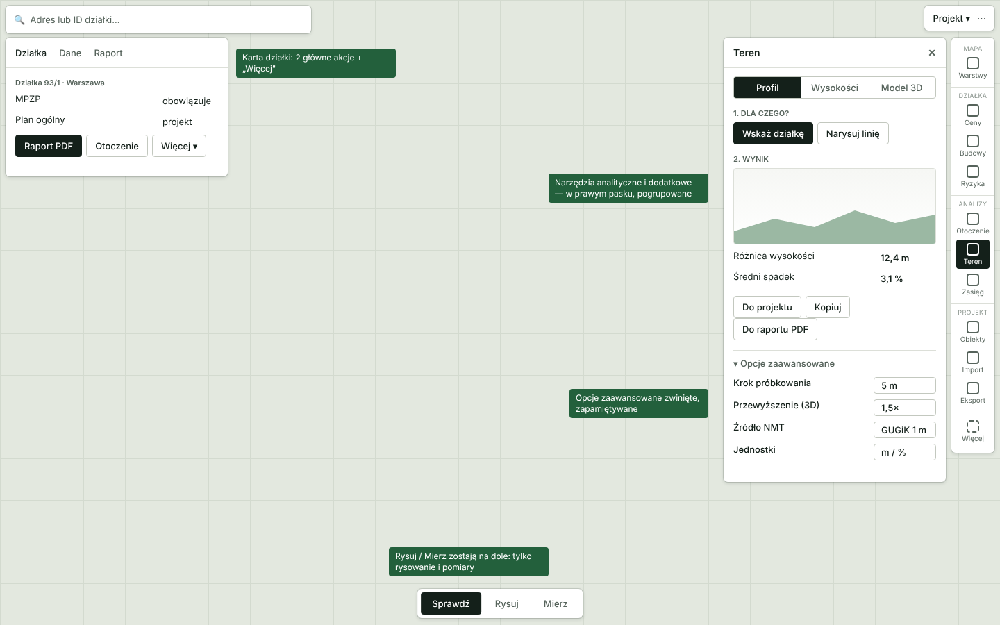

# Mapownik 19.49.0 — audyt funkcji, warstw i narzędzi oraz plan zmian

Data audytu: 11.11.2026. Dotyczy paczki `msportal-19.49.0-serwer` (z nakładką `ux2`).
Cel: naprawić albo usunąć to, co działa źle; narzędzia proste na pierwszy rzut oka, z opcjami zaawansowanymi pod ręką;
czytelne dla osób, które wchodzą od czasu do czasu; narzędzia dodatkowe w prawym pasku; łatwe dodawanie kolejnych.

## 0. Jak to sprawdzałem i czego nie wiem

| Co | Jak | Ograniczenie |
|---|---|---|
| 36 profili źródeł WMS | żywe zapytania GetMap dla Warszawy, gór i morza (z mojego środowiska) | **GDOŚ i PIG-MIDAS stoją za zaporą Imperva/Incapsula, która blokuje adresy centrów danych** (odpowiedź 403 z jej strony). Wynik „403” to więc wynik mojego adresu, nie dowód, że warstwa nie działa u Ciebie. Dokładnie tak samo opisują to Twoje dawne audyty (GDOŚ 403, PIG 502). Serwery GUGiK (`integracja.gugik.gov.pl`) resetowały u mnie połączenie. |
| 48 wierszy warstw w aplikacji | włączałem każdy wiersz na przybliżeniu ~1:1300 i liczyłem zapytania, błędy i stan wiersza | jw.; wolna sieć testowa zawyża liczbę „ładuje” |
| Narzędzia rysowania i pomiaru | wykonałem każde narzędzie na mapie, 0 błędów JavaScript | brak testu na urządzeniu dotykowym |
| Eksport PNG, zapis i udostępnianie projektu, paleta poleceń, Otoczenie, RCN | wykonane w przeglądarce / przez API | raport PDF i panel Budowy wymagają danych serwera, których w paczce nie ma |
| 1map.pl | strony opisowe (`/`, `/opis/`, `/application/1map`) | sama mapa wymaga logowania/JavaScript — **nie oglądałem jej interfejsu**, tylko opis funkcji |
| Kod aplikacji | brak źródeł w paczce; nazwy modułów (`PanelRegistry`, `toolGroups`, `ToolDock`, `ContextBar`, `commands`, `registerBuiltInPanels`) odczytałem z paczki diagnostyki | propozycje architektury opisują, **co i gdzie**, nie dokładne zmiany w kodzie |

**Pierwszy krok, który rozstrzyga większość wątpliwości:** uruchom na swoim hostingu OVH „Monitor źródeł danych”
(menu ⋯ → Monitor źródeł danych) albo `php tools/check_sources.php`. Z serwera OVH zobaczysz prawdziwy stan GDOŚ, PIG i GUGiK.

## 1. Streszczenie

1. **Wiele warstw to w istocie ta sama warstwa podana kilka razy.** 55 warstw (52 widoczne + 3 archiwalne; na liście 48 wierszy) da się sprowadzić do ok. 19 pozycji bez utraty czegokolwiek (sekcja 2).
2. **Największe ryzyko to 16 warstw za zaporą (GDOŚ ×10 + zbiorcze ×2, PIG-MIDAS ×3, SOPO).** Jeśli OVH też jest blokowany, cała ochrona przyrody i górnictwo będzie stale „niedostępna”.
3. **Martwe lub zdublowane:** ukryta warstwa NMT (jednolity obraz, 503, odpowiedź do 16 s), dwa „zestawy zbiorcze” powielające warstwy obok, trzy warstwy archiwalne, grupa z jedną warstwą.
4. **Komunikat błędu warstwy jest jedynie czerwonym „niedostępna”:** bez przyczyny, bez „Ponów”, bez informacji, że to usługa zewnętrzna.
5. **Narzędzia w „Mierz” nie są pomiarami:** Profil, Wysokości, Teren 3D i Bufor to analizy; powinny być w prawym pasku (zgodnie z Twoim zamysłem).
6. **Teren 3D bez wybranej działki nic nie pokazuje poza krótkim komunikatem u dołu;** Wysokości wymagają wyboru w dolnym panelu — brak prowadzenia krok po kroku.
7. **Karta Ceny mówi „brak transakcji”, choć w promieniu jest ich 5** (wszystkie odrzucone: udziały, małe działki). Użytkownik myśli, że nie ma danych.
8. **Dwa kluczowe elementy są jeszcze „otwarte” w Twoich audytach:** podkład OSM jako domyślny (polityka serwerów kafli OSM nie przewiduje stałego, intensywnego użycia przez aplikację) i autouzupełnianie adresów.
9. **Rysowanie, pomiary, eksport PNG, zapis i udostępnianie projektu działają** i mają już dobry wzorzec „prosto + Zaawansowane” (pasek stylu obiektu). Ten wzorzec warto rozszerzyć na wszystkie narzędzia.
10. **Architektura już ma rejestry (panele, polecenia, grupy narzędzi, profile źródeł w JSON).** Dodawanie narzędzi da się zamienić w „dodaj jeden plik” (sekcja 6).

## 2. Warstwy

Legenda decyzji: **zostaw** · **scal** (jedna pozycja z podwarstwami w „Zaawansowane”) · **usuń** · **sprawdź na OVH** (nie da się rozstrzygnąć z mojego środowiska).

### Działki i grunty (5 → 4)
| Warstwa | Stan (dowód) | Decyzja |
|---|---|---|
| Działki ewidencyjne (KIEG) | kluczowa; żądania biegną przez przekierowanie na `integracja01.gugik.gov.pl`; nakładanie etykiet z OSM jest znane (ZMIANY 19.46.0) | **zostaw**; od z≥17 rozważyć granice wektorowe (WFS/ULDK), co też rozwiąże etykiety |
| Granice administracyjne (PRG) | działa; 1 z 23 kafli zablokowanych (odpowiedź nie była obrazem) | **zostaw**; dodać automatyczne ponowienie kafla |
| Klasy bonitacyjne (EGiB) | min. skala 1:~2600; z mojego środowiska nieosiągalne | **sprawdź na OVH**; zostaw |
| Zasięg mapy glebowo-rolniczej + Mapa glebowo-rolnicza — kontury | zasięg: 100% (działa); kontury: puste w Warszawie (poza zasięgiem) | **scal** w „Gleby (mapa glebowo-rolnicza)”: zasięg jako podpowiedź na małych skalach, kontury na dużych |

### Planowanie przestrzenne (9 → 2)
Pięć pozycji o niemal identycznych nazwach: MPZP — obszary planów; POG — obszary planów ogólnych; Strefy POG — projektowane; Strefy POG — wiążące / realizowane; MPZP — rysunek planu (integracja). Osoba korzystająca od czasu do czasu nie odróżni ich bez czytania opisów.
Źródła odpowiadają (obszary MPZP: 30% pokrycia próbki w Warszawie, POG w trakcie przyjmowania: 98%); pokrycia stref nie zweryfikowałem (próbka poniżej ich skali).
**Decyzja — scal w dwie:**
- **Plan miejscowy (MPZP):** podwarstwy: obowiązujące / w trakcie / w opracowaniu / rysunek planu.
- **Plan ogólny (POG):** podwarstwy: obszary / strefy planistyczne, każde z filtrem „uchwalone / projekt / w opracowaniu”.

### Uzbrojenie terenu (8 → 1)
Sześć sieci + „sieci specjalne i niezidentyfikowane” + zestaw „Wszystkie sieci — KIUT” (dubluje pozostałe). Wszystkie z tego samego serwera GUGiK i tej samej minimalnej skali 1:~2600.
**Decyzja: scal** w „Uzbrojenie terenu (KIUT)” z przełącznikami sieci w „Zaawansowane”; **usuń** zestaw zbiorczy. Dodać stałe zastrzeżenie o niepełnym pokryciu sieci.
**Sprawdź na OVH** (GUGiK nieosiągalny z mojego środowiska).

### Energetyka (2 → 2)
Biogazownie KOWR (215 punktów orientacyjnych — działa), linie i stacje PSE (działa, 12/12 zapytań). **Zostaw.**

### Środowisko i wody (14 → 3)
| Pozycja | Stan | Decyzja |
|---|---|---|
| Powódź rzeczna / morska / przy awarii budowli | odpowiadają (200; dane widoczne nad rzekami i morzem) | **scal** w „Zagrożenie powodziowe” (3 podwarstwy) |
| Lasy — własność (BDL) | działa przez własny punkt (`forest.php`) | **zostaw** |
| GDOŚ: Natura 2000 ×2, parki narodowe, parki krajobrazowe, rezerwaty, OChK, użytki, zespoły, pomniki, stanowiska | **za zaporą Incapsula (403 u mnie)**; w aplikacji wszystkie wiersze „niedostępna” | **scal** w „Formy ochrony przyrody” (8 podwarstw) i **sprawdź na OVH**; jeśli zablokowane — plan awaryjny w sekcji 3 |

### Geologia i górnictwo (4 → 2)
Osuwiska SOPO (u mnie raz 403, raz 200, kafel do 15 s), złoża / obszary / tereny górnicze MIDAS (403/503). Archiwalne MIDAS (3) są już ukryte.
**Decyzja:** SOPO zostaje jako „Osuwiska”; MIDAS scalić w „Kopaliny i górnictwo”; **usunąć z katalogu** archiwa, jeśli nikt ich nie używa (nie wprowadzają zysku, a wyniki są niepewne).

### Rzeźba i wysokości (1)
„Nachylenie terenu” działa. Ukryta „Mapa wysokości NMT” zwraca jednolity obraz i bywa wolna (do 16 s, 503).
**Decyzja: usuń** wpis `nmt_hypsometry` z `source-profiles.json`; „Nachylenie” przenieś do „Teren” (razem z profilem i 3D, sekcja 4).

### Dane pomocnicze (9 → 4)
BDOT500, adresy KINA, nazwy PRNG, BDOT10k ×4 (użytkowanie, wody, drogi i kolej, budynki) oraz dwa zestawy zbiorcze GDOŚ, które dublują warstwy ze „Środowiska”.
**Decyzja:** zestawy zbiorcze **usuń**; BDOT10k **scal** w jedną warstwę z 4 podwarstwami; grupę przemianuj na „Podkłady tematyczne”. BDOT500 oznacz „tylko miasta”.

### Wynik
| | Dziś | Po zmianach |
|---|---|---|
| Warstwy | 55 (52 widoczne + 3 archiwalne; 48 wierszy) | ok. 19 pozycji (+ podwarstwy w „Zaawansowane”) |
| Grupy | 8 + ukryte „Archiwum” | 7 (Rzeźba przechodzi do narzędzia „Teren”) |
| Nowy zestaw „na jedno kliknięcie” | — | patrz sekcja 4 („Zadania”) |

### Wspólne poprawki dla warstw
1. **Stan błędu z przyczyną:** zamiast „niedostępna” → „Usługa GDOŚ nie odpowiada · Ponów · Szczegóły”. Przy zaporze — osobny tekst („dostawca blokuje serwer portalu”).
2. **Bez żądań, gdy z góry wiadomo, że źródło leży:** już jest (status źródeł); dodać ponawianie w tle co kilka minut i wyróżnić „wróciło”.
3. **Pojedyncze puste kafle** (PRG, BDOT10k drogi): ponowienie kafla zamiast cichej luki.
4. **Na liście zostają: tytuł, krycie, legenda, źródło, aktualność** (to już jest w panelu „i” — dobry wzorzec; dodać „Przybliż do zasięgu” i „Pokaż tylko tę” w jednym miejscu).
5. **Przy włączeniu warstwy poza zakresem skali:** już jest „Widoczna od ~1:2600 · Przybliż” — dobrze; ujednolicić z „Widoczna po oddaleniu”.

## 3. Dane i usługi na serwerze

| Funkcja | Stan | Co zrobić |
|---|---|---|
| Wyszukiwanie (miejscowość, adres, ID działki) | działa; po wyborze miejscowości pole dzieli się na „Ulica lub ID” i „Nr działki” — dla nowych osób niejasne | jedno pole + podpowiedzi „Warszawa, Marszałkowska 10 · działka 124 · 146510_8.0506.124”; autouzupełnianie (otwarte Z3) |
| Działka (ULDK) | działa, ~1,7 s | — |
| Ceny (RCN) | działa; znalazł 5 transakcji, wszystkie odrzucone → karta: „brak transakcji” | komunikat „5 transakcji w promieniu, żadna nie nadaje się do mediany (udziały, małe działki)” + przycisk „Pokaż transakcje” + zmiana promienia w jednym kliknięciu |
| Budowy i pozwolenia | wymaga bazy `data/rwdz/rwdz.sqlite` (210 MB); bez niej panel pokazuje komunikat o błędzie serwera | stan pusty „Brak danych na serwerze — wgraj bazę” widoczny tylko dla administratora; użytkownikowi „Dane chwilowo niedostępne” |
| Analiza otoczenia / budynki BDOT10k | lokalny magazyn budynków wskazuje `ready: false` w mojej kopii | sprawdź `api/health.php`: `bdot_store_ready`, `msportal_db_present` na OVH |
| Eksport PNG jak na ekranie | działa | — |
| Zapis i otwarcie pliku `.mapownik`, link do udostępnienia | działają | opisać w oknie, że link zapisuje projekt na serwerze (polityka prywatności) |
| Paleta poleceń (Ctrl+K) | co najmniej 40 poleceń, w tym trzy panele o tym samym znaczeniu: „Informacja o działce”, „Działka i otoczenie”, „Analizy” | uporządkować nazwy, jedna nazwa = jedna rzecz |
| Podkład OSM jako domyślny | otwarte „Z4” z audytu 19.41.4 | własny dostawca kafli (np. Omniscale, jak podaje 1map.pl w źródłach, lub MapTiler/Stadia), albo własne kafle |

**Plan awaryjny dla GDOŚ / PIG, jeśli OVH jest blokowany przez zaporę:**
1. Zapytać dostawcę o dopisanie adresu IP serwera (nic nie kosztuje).
2. Przełączyć te źródła na zapytania wprost z przeglądarki użytkownika (`transport: direct` w profilu źródła) — zapora nie blokuje zwykłych adresów domowych. Wymaga dopilnowania, aby odpowiedź błędu nie była traktowana jak obraz.
3. Docelowo: pobrać dane wektorowe GDOŚ (formy ochrony przyrody są małe, otwarte, aktualizowane rzadko) i serwować własne kafle/GeoJSON z cache. Daje szybkość, identyfikację obiektu i niezależność od zapory.

## 4. Narzędzia

### Rysowanie (11) i pomiar (6) — wynik testów
| Narzędzie | Wynik | Uwagi |
|---|---|---|
| Punkt, Linia, Poligon, Prostokąt, Okrąg, Strzałka, Tekst | działają; 7 obiektów w panelu „Obiekty” | okrąg i prostokąt mają w liście tę samą ikonę co poligon; obiekty bez dalszych opcji w „Zaawansowane” poza stylem |
| Etykieta ze wskazaniem, Edytuj kształt | dostępne | nietestowane w pełni |
| Dodaj działkę — szybki tryb | w rysowaniu | to narzędzie **działki**, nie rysowania → prawy pasek („Działka”) |
| Sprawdź przejazd (ciągnik z naczepą 16,5 m) | w rysowaniu | wąskie, zaawansowane → „Więcej narzędzi”, nie w głównym rzędzie |
| Zmierz odległość / powierzchnię | działają (214 m; 1,03 ha); wynik zostaje na mapie, „Dodaj do projektu”, „Kopiuj”, „Wyczyść” | pasek kontekstu obcina nazwę („Zmierz odległość Klikn…”); „Wynik Wymiar 214 m” — dwa słowa na to samo; w pasku widać tylko pole (obwodu i zmiany jednostek nie znalazłem); „Pomiar: Tymczasowy / Zapis w projekcie” to żargon → „Zostaw na mapie / Zapisz w projekcie” |
| Bufor | działa po zaznaczeniu obiektu | to analiza → pasek „Zasięg” |
| Profil wysokości | otwiera dolny panel „Profil terenu” | analiza → „Teren” |
| Wysokości obszaru | wymaga wyboru obszarów w dolnym panelu | analiza → „Teren”; dziś brak prowadzenia |
| Teren 3D | bez działki: komunikat u dołu „Kliknij działkę na mapie — otworzy się widok Teren 3D” | analiza → „Teren”; stan pusty z przyciskiem „Wskaż działkę” |

### Problemy wspólne
1. **Po Esc dok narzędzi wygląda na zwinięty do trzech przycisków** — w moim teście kolejne narzędzia przestały być klikalne, dopóki nie rozwinąłem grupy ponownie. Zostawić dok rozwinięty, dopóki użytkownik go nie zwinie (do potwierdzenia na urządzeniu).
2. **Pasek kontekstu jest ciasny**: nazwa, podpowiedź, opcje, wynik i akcje w jednym wierszu na 700 px. Rozdzielić: nazwa + podpowiedź | wynik | akcje; opcje w „Zaawansowane”.
3. **Każde narzędzie wymaga innego celu** (działka, obiekt, narysowany obszar, linia). Dziś użytkownik musi to zgadnąć. Ujednolicić „Dla czego?” (sekcja 5).
4. **Nazwy z żargonem:** „Wymiar”, „Tymczasowy”, „Analiza źródła”, „Otoczenie działki”, „Wysokości obszaru” → opisać czynność.

### Co zostaje w dolnym docku
Tylko **Sprawdź · Rysuj · Mierz** (odległość, powierzchnia, kąt). Wszystko, co jest analizą, trafia do prawego paska.

## 5. Docelowy układ



*Schemat poglądowy, nie makieta ostateczna.*

### Prawy pasek — narzędzia dodatkowe, pogrupowane
| Grupa | Narzędzia | Skąd się biorą |
|---|---|---|
| **Mapa** | Warstwy (z „Zadaniami” — sekcja poniżej) | Warstwy |
| **Działka** | Ceny, Budowy, Ryzyka (powódź, ochrona, osuwiska), *(przyszłość: Czyj las)* | Ceny, Budowy, część warstw środowiskowych |
| **Analizy** | Otoczenie, **Teren** (Profil · Wysokości · Model 3D · Nachylenie), **Zasięg** (bufor) | Analizy, Profil, Wysokości, Teren 3D, Bufor |
| **Projekt** | Obiekty, **Import** (pliki GIS + lista działek), Eksport (PDF, PNG, obraz z serwera) | Obiekty, Import/eksport GIS, Eksport |
| **Więcej** | Porównanie działek, Sprawdź przejazd, nowe narzędzia | Porównanie, przejazd |

Zasady: grupy z mikro-nagłówkami (nie więcej niż 3 pozycje w grupie na raz widoczne bez przewijania), jedna aktywna pozycja naraz, ikona + podpis zawsze (nie tylko ikona), kolejność niezmienna u użytkownika, „Więcej” otwiera listę z wyszukiwarką.

### Jak ma wyglądać każde narzędzie
1. **Dla czego?** — jeden wybór celu: „Wskaż działkę” · „Wybrana działka” · „Narysuj obszar” · „Obiekt z projektu”. Pierwsza akcja zawsze główna (ciemny przycisk).
2. **Wynik** — liczby i wykres od razu, z sensownymi wartościami domyślnymi (bez konfigurowania).
3. **Akcje** — Do projektu · Kopiuj · Do raportu PDF.
4. **▾ Opcje zaawansowane** — zwinięte, **zapamiętywane per narzędzie** (krok próbkowania, przewyższenie, źródło danych, jednostki, promienie, okresy). Pasek stylu obiektu już działa tak i jest wzorem.
5. **Stan pusty** — jedno zdanie + jeden przycisk. Błąd — przyczyna + „Ponów”.
6. **Pomoc** — „?” przy nagłówku otwiera dwuzdaniowy opis i skrót klawiszowy.

### Co przejąć z 1map.pl (według opisów publicznych)
| Funkcja 1map.pl | Dla Mapownika |
|---|---|
| Osobne „aplikacje” do jednego celu: Ceny, Plany, Pozwolenia na budowę, Czyj las, Tereny zalewowe | **„Zadania” w Warstwach**: Plan zagospodarowania · Ceny okolicy · Ryzyka (powódź, ochrona) · Uzbrojenie · Energetyka (KOWR, PSE). Jedno kliknięcie włącza zestaw warstw i otwiera właściwy panel. To zastępuje przeglądanie 48 wierszy |
| Wybór tła: „Archiv”, „Ortofotomapa”, „Bez tła” | już jest podkład; dodać „Bez tła” oraz **porównanie ortofotomapy z różnych lat** (suwak) |
| Panel „Importuj geodane” (GeoJSON, KML, GML, GPX, GeoTIFF, automatyczny układ) | **Import** w pasku: przeciągnij plik; dziś jest w „Obiektach → Import i eksport plików GIS” (ukryte) |
| „Lista działek”: wklej numery → pokaż na mapie, komunikat o błędach | **Lista działek** w Imporcie; w Mapowniku są już ULDK i porównanie działek, więc to mała zmiana, duża użyteczność |
| Legenda przy warstwach | już jest w panelu „i” warstwy; pokazać ją też jako przycisk „Legenda” w nagłówku panelu |
| Informacje o obiekcie po kliknięciu | już jest (karta działki) |
| Street View | zwykły link „Street View” z punktu na mapie — tani i lubiany |
| Źródła danych i licencje + zastrzeżenie „dane poglądowe” | stała strona „Źródła i licencje” generowana z profili źródeł (są w nich dostawca, link i data weryfikacji) |
| Wersja abonamentowa: notatki, projekty, zadania, zespół | poza zakresem; Twoje projekty `.mapownik` i link do udostępnienia to zalążek |

## 6. Architektura pod dalszą rozbudowę

W paczce widać już rejestry: `PanelRegistry`/`registerBuiltInPanels`, `toolGroups`/`ToolDock`, `commands`, `ContextBar`, profile źródeł w `data/source-profiles.json`.
Propozycja to uporządkowanie ich w **jedną definicję narzędzia**, z której wszystko powstaje samo:

```ts
// app/tools/teren.tool.ts — jedyny plik, który trzeba dodać
export default defineTool({
  id: 'teren',
  title: 'Teren',
  icon: IconMountain,
  placement: { rail: 'analizy', order: 20 },        // prawy pasek, grupa „Analizy”
  needs: ['parcel', 'drawnArea', 'line'],            // czego może dotyczyć (steruje „Dla czego?”)
  modes: ['profil', 'wysokosci', 'model3d'],         // segmenty u góry panelu
  panel: () => import('./TerenPanel'),               // ładowany przy pierwszym otwarciu
  advanced: schema({ krok: number(5), przewyzszenie: number(1.5), zrodloNmt: enumOf([...]) }),
  commands: [{ id: 'teren.profil', title: 'Profil terenu', shortcut: 'F' }],
  result: ['toProject', 'copy', 'toReport'],         // wspólne akcje wyniku
  help: 'Profil, wysokości i model 3D działki lub linii.',
});
```
Z jednej definicji powstają: pozycja w prawym pasku, wpis w palecie poleceń, skrót, okno pomocy, formularz „Zaawansowane” (z walidacją schematem), stan pusty i test (szablon).
Dla warstw analogicznie: `data/layers/*.json` z polami `id, title, group, task[], sublayers[], minScale, legend, license, transport, healthCheck` — z jednego wpisu wynikają lista, legenda, strona „Źródła i licencje”, monitor i zadania.

**Reguły dla przyszłych narzędzi** (do zapisania w `README_PROGRAMISTY.md`):
1. Każde narzędzie ma „Dla czego?”, wynik, akcje wyniku, „Zaawansowane”, stan pusty i błąd.
2. Nie ma narzędzia bez polecenia w palecie i bez testu Playwright.
3. Nowa warstwa = nowy wpis w katalogu + wynik `healthCheck` przed wdrożeniem.
4. Teksty: czasownik + przedmiot („Zmierz odległość”), bez żargonu.

## 7. Plan wdrożenia

| Etap | Zakres | Ryzyko | Efekt dla użytkownika |
|---|---|---|---|
| **0** (1 dzień) | Monitor źródeł z OVH; `api/health.php` na OVH; decyzja o OSM i GDOŚ | brak | wiadomo, co naprawdę nie działa |
| **1** (2–4 dni) | Porządki w katalogu warstw (scalenia, usunięcia z sekcji 2); komunikat błędu z przyczyną i „Ponów”; komunikat „brak transakcji” z liczbą; stan pusty Terenu 3D; dok narzędzi nie zwija się po Esc | niskie (dane i teksty) | krótsza lista, jasne komunikaty |
| **2** (1–2 tyg.) | Prawy pasek z grupami; przeniesienie Profilu/Wysokości/3D/Bufora; ujednolicony panel „Dla czego? → Wynik → Akcje → Zaawansowane” | średnie (układ) | spójna obsługa |
| **3** (1–2 tyg.) | „Zadania” w Warstwach; Import + Lista działek; „Bez tła” i Street View | niskie | skróty do typowych celów |
| **4** (2–4 tyg.) | Definicja narzędzia (`defineTool`) i katalog warstw w JSON; szablon testu; strona „Źródła i licencje” | średnie (refaktor) | łatwe dodawanie nowych narzędzi |
| **5** (wg potrzeb) | Własne kafle podkładu; mirror danych GDOŚ/PIG; porównanie ortofotomapy z lat; autouzupełnianie adresu | wyższe | niezależność i szybkość |

**Kryterium odbioru dla osoby wchodzącej raz na jakiś czas:** pięć zadań wykonanych bez instrukcji w ≤3 kliknięciach: „sprawdź działkę”, „czy jest plan miejscowy”, „czy zagraża jej powódź”, „zmierz odległość”, „zrób raport PDF”.

### Uwaga o moich wcześniejszych zmianach (`ux1`/`ux2`)
Nakładka CSS i `ux.js` przenoszą pasek kontekstu na dół ekranu i dodają „Eksport” do paska — to zmiany wprowadzone bez źródeł. Etap 2 Twojego własnego planu (19.49.0) świadomie umieścił pasek kontekstu u góry mapy.
Przy przeniesieniu do źródeł należy zdecydować jedno miejsce; nakładka jest tymczasowa i znika po Etapie 2.

## 8. Decyzje, które muszą zapaść po Twojej stronie
1. Czy GDOŚ/PIG zostają, jeśli OVH jest blokowany (plan awaryjny 1/2/3 z sekcji 3)?
2. Podkład domyślny: zostaje OSM, czy płatny/własny dostawca?
3. Czy usuwamy archiwa MIDAS i ukryty NMT definitywnie?
4. Czy „Zadania” (Plan / Ceny / Ryzyka / Uzbrojenie / Energetyka) mają być w głównym menu warstw czy jako osobne przyciski w prawym pasku?
5. Czy Mapownik ma mieć notatki i projekty zespołowe jak wersja płatna 1map.pl, czy zostaje przy plikach `.mapownik`?
