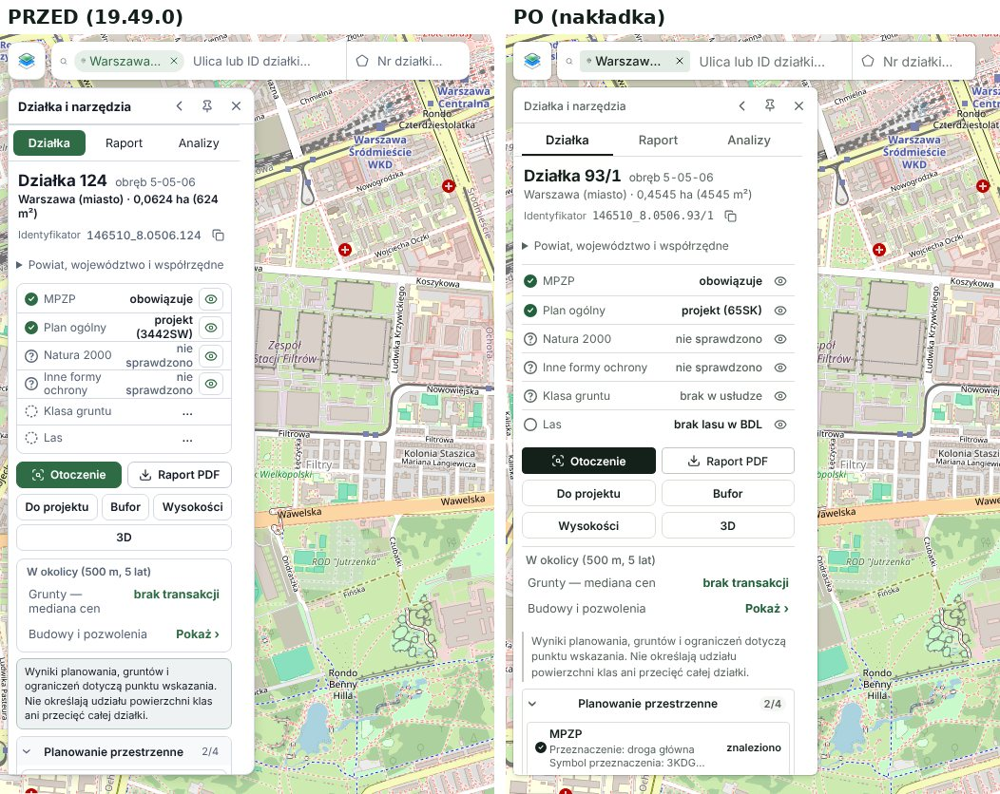

# Mapownik 19.49.0 — audyt interfejsu i propozycja zmian

Audyt zrobiony na działającej paczce `msportal-19.49.0-serwer` (uruchomionej lokalnie, komputer 1440×900 i telefon 390×844,
motyw jasny i ciemny). Paczka zawiera tylko zbudowany kod, bez źródeł React, dlatego praca ma dwie części:

1. **Zrobione i sprawdzone:** nakładka stylu `assets/css/95-odswiezenie.css` — działa na obecnej paczce bez zmian w kodzie.
2. **Do zrobienia w źródłach:** zmiany układu i uproszczenia obsługi (sekcja 3) — wymagają edycji komponentów.

## 1. Co jest dobre i zostaje

- Mapa na cały ekran, wyszukiwarka u góry, narzędzia na dole, panele po prawej, karta działki po lewej.
- Trzy tryby pracy (Sprawdź / Rysuj / Mierz) zamiast długiego paska ikon.
- Układ telefonu z dolną nawigacją.

## 2. Nakładka stylu (gotowa)

Skąd bierze się wrażenie „szablonu": siedem różnych promieni zaokrągleń (4–12 px i pastylki), rozmyte cienie pod
półprzezroczystymi kartami, zielone wypełnienie użyte jednocześnie dla zakładki, przycisku, trybu i akcji głównej,
karty zagnieżdżone w kartach.

Co zmienia nakładka:

| Obszar | Przed | Po |
|---|---|---|
| Kolor | zieleń jako wypełnienie wszystkiego, co aktywne | ciemny „atrament" dla stanu aktywnego i akcji głównej; zieleń tylko jako sygnał (wynik, odnośnik) |
| Kształt | promienie 4/5/6/7/8/10/12 px | dwa: 6 px (karty) i 4 px (kontrolki) |
| Głębia | rozmyty cień, półprzezroczyste tła | cienka krawędź + krótki cień, tła pełne |
| Zakładki | wypełniona pastylka (wygląda jak przycisk) | podkreślenie — zakładka różni się od przycisku |
| Karta działki | ramki w ramkach, wartości łamane w 2 wiersze | linie rozdzielające, wartości w jednym wierszu, akcje w równej siatce 2×2 |
| Liczby | proporcjonalne | tabelaryczne; identyfikator działki, skala i podziałka pismem o stałej szerokości |
| Warstwy | 4 filtry-kafelki z licznikami „0", ucięte „Wszystkie" | pasek zakładek bez liczników (liczbę aktywnych podaje nagłówek) |
| Tekst | zdanie wstępu nad listą czynności; etykieta nad polem szukania w telefonie | usunięte (powtarzały sąsiedni element) |
| Zastrzeżenie w karcie | szare pudełko | przypis z linią z lewej |
| Telefon | pastylki, duże rozmyte cienie | te same krawędzie i promienie co na komputerze |

Porównania: [ekran startowy](audyt-ui/start.jpg) · [karta działki](audyt-ui/identify.jpg) · [warstwy](audyt-ui/layers.jpg) ·
[rysowanie](audyt-ui/draw.jpg) · [eksport](audyt-ui/export.jpg) · [analizy](audyt-ui/analizy.jpg) ·
[telefon](audyt-ui/mob.jpg) · [motyw ciemny](audyt-ui/dark.jpg)

Na zrzutach „po" karta działki ma 320 px (ustawione uchwytem) — to proponowana szerokość domyślna, patrz 3.4.

### Jak włączyć

- **W źródłach (docelowo):** plik do `assets/css/`, w źródłowym `index.html` jako ostatni `<link rel="stylesheet">`.
  Arkusz jest poza warstwami `@layer`, więc wygrywa z istniejącymi regułami bez `!important`.
- **Szybka próba na serwerze:** wgrać plik do `assets/css/` i dopisać w zbudowanym `index.html`, przed `<link rel="manifest">`:
  `<link rel="stylesheet" href="./assets/css/95-odswiezenie.css?v=1" />`. CSP (`style-src 'self'`) na to pozwala.
- Wycofanie: usunięcie tej jednej linii.

### Zakres sprawdzenia

Obejrzane po zmianie: ekran startowy, karta działki (Działka, Analizy), Warstwy, Obiekty, Ceny, Budowy, Eksport, menu Projekt
i ustawień, tryby Rysuj i Mierz, motyw ciemny, telefon (start, Warstwy, Rysuj).
Nie sprawdzone: okno raportu PDF, widok 3D i profil terenu, paleta poleceń po zmianie, wydruk, prawdziwe urządzenie dotykowe,
testy e2e projektu (nie ma ich w paczce).

## 3. Zmiany układu — do zrobienia w źródłach

Kolejność według wpływu na prostotę obsługi.

### 3.1 Jedno miejsce na panele, mniej przycisków w prawym górnym rogu
Dziś panele otwiera się z trzech miejsc: szyna (Warstwy, Obiekty, Ceny, Budowy), przycisk Eksport (też panel, ale poza szyną)
i menu Projekt. Obok są jeszcze pomoc i ustawienia — razem 5 elementów w rogu.
**Propozycja:** Eksport jako piąta pozycja szyny (pod separatorem). W rogu zostają dwa elementy: `Projekt` (z kropką zapisu)
i jedno menu `⋯` łączące ustawienia, pomoc i skróty.

### 3.2 Logo nie powinno być ukrytym przyciskiem
Logo otwiera paletę poleceń — nikt tego nie zgadnie. **Propozycja:** paleta w polu wyszukiwania (ta sama lista: miejsca,
działki, polecenia; podpowiedź `Ctrl K` po prawej stronie pola). Logo bez funkcji albo „O Mapowniku".

### 3.3 Pasek kontekstu narzędzia przy narzędziach
Po wybraniu „Poligon" na dole wskazówka i opcje pojawiają się u góry ekranu — wzrok skacze przez całą mapę.
**Propozycja:** pasek kontekstu bezpośrednio nad dolnym paskiem narzędzi (jedna grupa). Lista „Po dodaniu: Zakończ/…"
dubluje ustawienie „Dodawaj kolejne obiekty" — zostawić jedno, jako przełącznik-ikonę w pasku.

### 3.4 Karta działki
- Nagłówek „Działka i narzędzia" zajmuje wiersz i nic nie mówi — usunąć; zwiń/przypnij/zamknij przenieść do wiersza zakładek.
- Domyślna szerokość 260 → 320 px (przy 260 łamią się „0,0624 ha (624 m²)", „nie sprawdzono", nagłówki sekcji).
- Stan pusty: trzy wiersze powtarzają pole szukania i pomoc. Bez wybranej działki karta zwinięta do wiersza zakładek.
- Akcje: 6 przycisków → `Raport PDF` (główna), `Otoczenie`, `Więcej ▾` (Do projektu, Bufor, Wysokości, 3D).
- Te same źródła są pokazane dwa razy: lista werdyktów (MPZP, Plan ogólny…) i niżej sekcje ze szczegółami.
  Jedna lista — wiersz werdyktu rozwija szczegóły pod sobą.
- Zastrzeżenie o punkcie wskazania → ikona `i` przy nagłówku listy.

### 3.5 Nazwy: trzy różne „raporty", dwa „otoczenia"
Zakładka `Raport`, przycisk `Raport PDF` i `Raport działki PDF` w Eksporcie to trzy różne rzeczy. `Otoczenie` jest przyciskiem
w zakładce Działka i pod-zakładką w Analizach. **Propozycja:** zakładki `Działka · Dane · Analizy`; „Raport" znaczy wyłącznie PDF;
przycisk Otoczenie przełącza na Analizy z gotowym wynikiem.

### 3.6 Panele po prawej
- Domyślna szerokość 250 → 300 px (ucięte nazwy warstw, np. „Klasy bonitacyjne I–VI i użytki (E…").
- Podtytuły nagłówków („Rejestr Cen Nieruchomo…", „Obraz mapy i kadr") — usunąć; są ucięte albo powtarzają tytuł.
- Warstwy: filtry `Wszystkie / Włączone`; „W widoku" i „Ulubione" do menu `⋯`. Liczniki grup („0/5") tylko gdy coś włączono.
- Ceny: zamiast zdania „Przybliż mapę — narzędzie pokazuje…" przycisk `Przybliż do zasięgu`.
- Eksport: trzy karty z akapitami → trzy wiersze (`Raport PDF`, `Obraz PNG`, `Obraz z georeferencją`), opis w podpowiedzi;
  dwie stopki informacyjne do usunięcia.
- Listy rozwijane systemowe → komponent z biblioteki, która już jest w paczce (Radix), jedna wysokość kontrolek.

### 3.7 Drobne
- „Jak zacząć" otwiera się na wierzchu otwartego panelu i szyny — zamykać panel albo pokazać jako okno.
- Dolny pasek narzędzi przesuwa się w bok, gdy otwiera się panel — zakotwiczyć względem okna.
- Logo jest niebieskie, interfejs zielony — ujednolicić (logo w kolorze atramentu albo jednej zieleni).
- Telefon: „Orto / Uzbrojenie / Działki" są nad mapą i drugi raz w arkuszu Warstwy („Szybkie warstwy") — zostawić jedno miejsce.

## 4. Proponowana kolejność

1. Wdrożyć nakładkę (bez ryzyka dla logiki, jedna linia do wycofania).
2. 3.4 i 3.6 — szerokości domyślne, usunięcie nagłówków i podtytułów (małe zmiany, duży efekt).
3. 3.1–3.3 — nawigacja.
4. 3.5 — nazwy (wymaga też zmian w pomocy i tekstach raportu).

## 5. Status wdrożenia (paczka `dist/msportal-19.49.0-ux4-serwer.zip`)

Wykonane bez źródeł (CSS + `assets/js/ux.js`, szczegóły w [ZMIANY_19.49.0-ux4.md](ZMIANY_19.49.0-ux1.md)):
3.1 Eksport w szynie (górny róg: Projekt, pomoc, ustawienia), 3.3 pasek kontekstu nad dolnym paskiem narzędzi,
3.4 bez nagłówka karty i szerokość 320 px, 3.6 szerokość 300 px i brak podtytułów, 3.7 powtórzona etykieta w telefonie.

Wymagają źródeł aplikacji (nie ruszane): połączenie pomocy i ustawień w jedno menu, paleta poleceń w polu wyszukiwania (3.2),
„Więcej" w akcjach karty i jedna lista źródeł (3.4), zmiana nazw (3.5), komponenty zamiast list systemowych (3.6),
okno „Jak zacząć" i kolor logo (3.7), „Szybkie warstwy" w telefonie.

Sprawdzone na paczce rozpakowanej od zera: kontrola wdrożenia (`verify-deployment.php`) = spójne, service worker instaluje
się z nowymi plikami, aplikacja otwiera się offline z nowym wyglądem.
